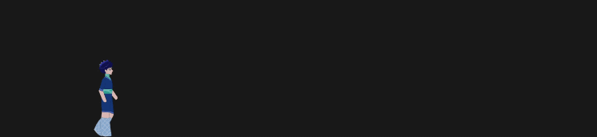
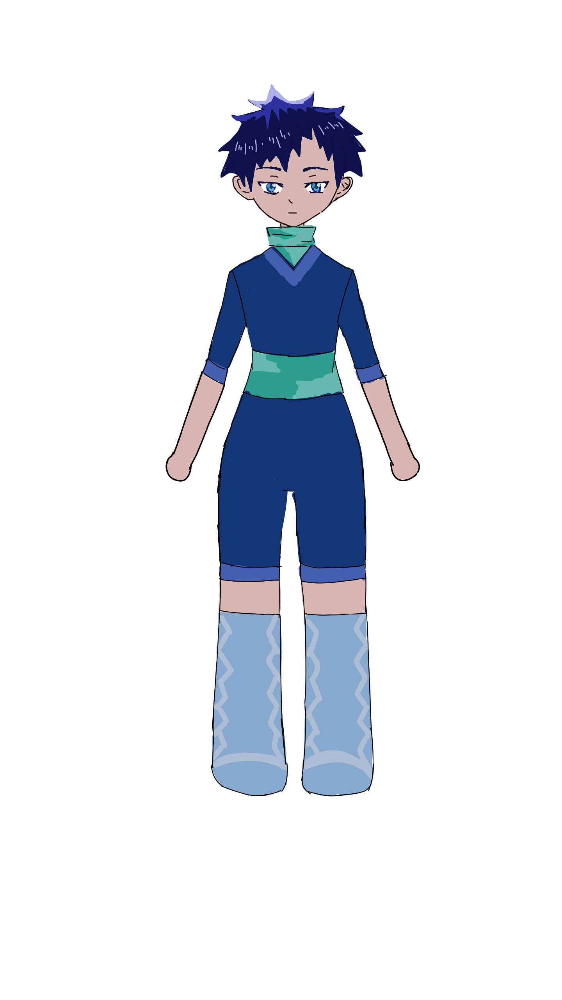
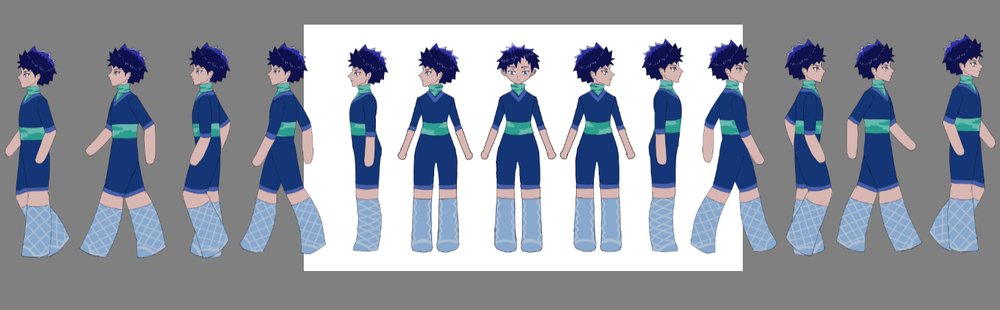

# 💧 Browser Companion

A browser extension that adds a gentle animated character to your screen. Built as a personal project to learn JavaScript, animation timing, and browser extension development.

## screenshots and video

## 🛠️ Built With
- **Vanilla JavaScript** — DOM manipulation, timing with `setTimeout` and `setInterval`, state management
- **Browser Extension API** — Content scripts, resource handling with `web_accessible_resources`
- **Krita** — All character artwork and animation frames drawn by hand

## 🎯 Key Concepts Practiced
- Animation sequencing — head turn → body turn → walk
- State control — preventing overlapping actions
- Image swapping and timing control
- Manifest configuration and resource permissions

## 📦 Installation
- Clone the repo
- Load as unpacked extension in your browser
- That's it — meet your new quiet friend 💙
